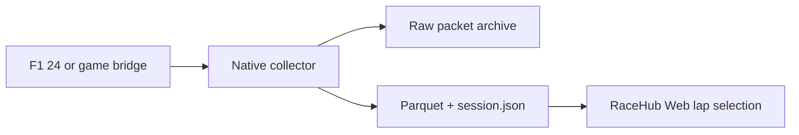

# RaceHub native telemetry

RaceHub is a free, open source system for local racing telemetry analysis.
This repository provides its native UDP collector and Parquet writer.
Use it with F1 24, the RaceHub iRacing bridge, or the RaceHub rFactor 2 broadcaster.
No RaceHub account, subscription, or cloud service is required.

RaceHub applies CC0 1.0 only to rights it owns in its original contributions.
Read the exact [licence scope](LICENSING.md) and [CC0 terms](LICENSES/CC0-1.0.txt).
Other contributors, dependencies, game interfaces, SDKs, and recordings keep their own terms.
The games themselves are separate products.

## How the projects connect

| Project | Role |
| --- | --- |
| [racehub-web](https://github.com/racehub-io/racehub-web) | Local recorder controls, recording library, lap comparison, charts, and recorded world paths. |
| **racehub-rust**, this repository | Receives UDP directly. Decodes packets. Saves original packets and source-rate Parquet. |
| [racehub-iracing-udp](https://github.com/racehub-io/racehub-iracing-udp) | Reads the iRacing SDK on Windows and sends its RaceHub Protobuf packets. |
| [rfactor2-udp-broadcaster](https://github.com/racehub-io/rfactor2-udp-broadcaster) | Sends rFactor 2 telemetry and scoring packets from a Windows game plug-in. |
| [f1-telemetry-client](https://github.com/racehub-io/f1-telemetry-client) | The JavaScript F1 parser used by the web application's sampled JSON mode. |
| [racehub-client-python](https://github.com/racehub-io/racehub-client-python) | An existing Python collector. The web application can import its supported exports. |

The native path is:



The game or bridge controls the source frequency.
The native collector does not pass packets through the JavaScript F1 parser.
Its small live preview does not set the stored frequency.
RaceHub Web supplies the local HTTP API and browser interface.
You can also use the native command line without the web application.

## Quick start

Install stable Rust with Cargo and a C/C++ build toolchain for your operating system.
The build compiles native dependencies, including bundled SQLite and Zstd.
The native collector does not need Python, a game SDK, or `protoc` at build time.
The separate game bridges have their own requirements.

From the repository root, run:

```sh
cargo build --release --locked -p aggregator
cargo run --release --locked -p aggregator -- capture --simulator f1 --output-dir recordings/f1-session
```

Enable UDP telemetry in F1 24.
Set its destination to `127.0.0.1`, port `20777`, and the F1 24 packet format.
Start a game session and drive.
Keep the collector terminal open.
Enter `stop`, then press Enter, to save the recording.
Use a new output directory for each recording.

The same Cargo command works on Windows, Linux, and macOS.
The game or bridge must run on a platform that it supports.
If it runs on another computer, use the network configuration below.
The first build needs internet access to obtain dependencies.
Recording and analysis then run locally.

The built executable is `target/release/aggregator` on Linux and macOS.
On Windows, it is `target\release\aggregator.exe`.
You can use this executable instead of `cargo run`.

## Use the web analyser

Clone [racehub-web](https://github.com/racehub-io/racehub-web) beside this repository.
Follow its build and start instructions.
The web server finds the sibling `racehub-rust/target/release/aggregator` executable.
It uses the `.exe` suffix on Windows.
If the binary is elsewhere, set `RACEHUB_NATIVE_BINARY` to its full path before you start the web server.
Restart the server after you build or change the binary.

In **Local recorder**:

1. Select the game.
2. Select **Parquet - full game rate**.
3. Select the player or all drivers.
4. Start recording, then drive.
5. Select **Stop and analyse** when you finish.

The web server starts and stops the native process.
It stores native recordings under its data directory.
The default is `~/Documents/RaceHub/sessions/native`.
The browser reads selected laps from Parquet parts through file slices or HTTP range requests.
The web application's README explains imports, exports, browser storage, and optional self-hosting.

Native F1 decoding currently supports F1 24 only.
For other F1 formats supported by the JavaScript parser, use **Sampled JSON** in RaceHub Web.

## Configure the game or bridge

| Simulator argument | Source | Default UDP port | Important limits |
| --- | --- | --- | --- |
| `f1` | Built-in F1 24 UDP output | `20777` | Other game years are rejected. Available channels also depend on driver privacy settings. |
| `iracing` | RaceHub iRacing UDP bridge | `20900` | Most driving channels belong to the player. The protocol has no world coordinates. |
| `rfactor2` | RaceHub rFactor 2 broadcaster | `20888` | Enable both telemetry and scoring. Scoring provides player and track information. |

For iRacing, install and run the linked bridge on the Windows game computer.
Its default destination is `127.0.0.1:20900`.
Its configuration file is `%USERPROFILE%\Documents\RaceHub\iracing_config.json`.
The bridge frequency controls how often it sends source packets.
Use the bridge README for installation and configuration.

For rFactor 2, build and install the linked broadcaster with its required SDK and libraries.
Enable telemetry and scoring.
Keep `BroadcastToNetwork` off for a collector on the same computer.
Set `BroadcastPort` to `20888`, or change both the plug-in and collector ports.
The broadcaster repository gives the source build requirements.
A ready Windows plug-in binary is not included here.

For another computer on your LAN, bind the collector to the receiving interface:

```sh
cargo run --release --locked -p aggregator -- capture --simulator f1 --host 0.0.0.0 --port 20777 --output-dir recordings/f1-lan-session
```

For F1 and iRacing, set the game or bridge destination to the collector computer's LAN address.
For rFactor 2, set `BroadcastToNetwork` to 1 and keep `BroadcastPort` equal to the collector port.
That plug-in sends to `255.255.255.255`. It does not have an arbitrary destination IP setting.
The receiver must listen on the same LAN for that broadcast.
Allow only the required UDP traffic through its firewall.
Keep web control on loopback unless you configure the web application's private self-hosting route.

## Command-line options

Use these commands to read the complete built-in help:

```sh
cargo run --release --locked -p aggregator -- --help
cargo run --release --locked -p aggregator -- capture --help
cargo run --release --locked -p aggregator -- convert --help
```

| Option | Applies to | Meaning |
| --- | --- | --- |
| `--simulator` | `capture`, `convert` | Required. Select `f1`, `iracing`, or `rfactor2`. |
| `--output-dir` | `capture`, `convert` | Required. Use a new directory, or one that contains only the recorder lock file. Existing recording files are not overwritten. |
| `--scope` | `capture`, `convert` | `player` by default. Select `all` to store all available driver rows. |
| `--name` | `capture`, `convert` | Recording name. The default is `Native recording`. The maximum is 256 bytes. |
| `--recording-id` | `capture`, `convert` | Optional UUID. The collector generates one if omitted. |
| `--host` | `capture` | Local bind IP address. The default is `127.0.0.1`. |
| `--port` | `capture` | UDP port. The simulator's default applies if omitted. |
| `--input` | `convert` | Required path to a supported raw archive or line-delimited raw packet recording. |
| `--source-session-id` | `convert` | Optional exact source session ID. It filters projected rows to that source. |

The native CLI uses flags for these settings.
`RACEHUB_NATIVE_BINARY` is a setting for the web server, not for the native CLI.

Player capture waits until the protocol identifies the player.
Use `all` for a spectator recording when no player exists.
"All drivers" means all rows that the protocol and privacy settings make available.
It does not create channels that the game did not send.

## Rate, status, and stopping

The collector stores decoded rows at the source rate.
It has no fixed recording row limit or 10 Hz sampling limit.
Available disk space and processing capacity still limit a capture.

The receive queue holds at most 1,024 packets.
If it fills, capture stops with a visible error.
The collector also stops on a row conversion or storage error, a source session change,
or a source clock rewind greater than two seconds.
The rFactor 2 adapter treats a rewind greater than one second as a new source session.
Smaller packet reordering can be accepted within those protocol checks.
Start a new recording after a flashback or restart.

Enter `stop`, send EOF, or press Ctrl+C for an orderly stop.
On Unix, SIGTERM also uses this stop path.
The process stops receiving packets, drains accepted packets, and completes the files.
After a projection error, it still attempts to preserve queued raw packets.

Standard output contains one JSON event per line:

| Event | Meaning |
| --- | --- |
| `ready` | The UDP socket and recording are ready. Includes ID, simulator, scope, and actual port. |
| `status` | Reports `received`, `rejected`, `dropped`, `rows`, and an error if present. |
| `sample` | A preview of at most 22 actual rows, at most twice per second. |
| `complete` | Files are completed. Includes compact session metadata. Read `session.json` for the full part list. |
| `error` | A command or process error. |

`received` counts datagrams read by the collector.
`rejected` counts packets that it could not decode.
`dropped` counts packets that could not enter the writer queue.
It cannot count packets lost before the receive call in the network or operating system.
`rows` counts projected telemetry rows, not packets.
One packet can produce several driver rows, or no rows.

Check status errors and the final manifest's `error` field as well as the process exit code.
A completed recording can contain an error and still have usable rows.
A zero-row result means no analysable telemetry was saved.
Original packet files can still contain useful input for diagnosis or recovery.

## Recording files

| File | Contents |
| --- | --- |
| `session.json` | Session identity, simulator, track metadata, source session ID, counters, state, and file lists. |
| `part-*.parquet` | Completed, immutable Parquet parts with Zstd compression. |
| `original-*.rhc` | Original UDP packet bytes with receive timestamps. The header identifies the raw format. |
| `*.tmp` | A file that has not completed its final atomic replacement. |
| `.capture.lock` | The operating system file lock that prevents two writers in one directory. |

The recorder updates `session.json` through an atomic file replacement.
Completed Parquet parts are synced before they receive their final names.
The manifest state is `recording` during capture and `complete` after finalization.

Parquet parts normally contain 65,536 rows.
Row groups contain at most 8,192 rows.
An estimated 16 MiB decoded group budget can close a group early.
A new channel can close a part early because each part has one schema.
Rows are sorted by participant and time within each row group.
The parts keep capture order. They are not one globally sorted table.

The Parquet footer key `racehub` contains session metadata as JSON.
Use the final manifest for the latest track metadata and the full ordered part list.
The [developer guide](capture/README.md) describes the fields and binary formats.

## Channels and units

Rows have `participantId` and `sessionTime`.
Measured channels stay sparse at their own source times.
Missing values stay absent in rows and become nulls in Parquet.
`packetId` identifies the source packet family where the adapter supplies it.
F1 rows also retain `frameId`.
Source session IDs remain text so a 64-bit ID does not lose precision.

| Channel | Stored unit or meaning |
| --- | --- |
| `sessionTime` | Seconds on the simulator's session clock. |
| `lap_time`, `last_lap_time`, sector times | Milliseconds. |
| `lap_distance`, `track_length`, `world_x`, `world_y`, `world_z` | Metres. |
| `speed` | Kilometres per hour. |
| `throttle`, `brake` | Ratios from 0 to 1. |
| `steer` | Normalized steering from -1 to 1, when the source defines it. |
| `steer_angle` | iRacing steering angle in degrees. It is not converted to a ratio. |
| `clutch` | F1 percentage; iRacing and rFactor 2 ratio. |
| `engine_rpm` | Revolutions per minute. |
| `tyre_pressure_*` | PSI for the mapped F1 and rFactor 2 channels. |
| `fuel_in_tank`, `fuel_capacity` | F1 kilograms; rFactor 2 litres. These units are not interchangeable. |

Carried lap values have `lap_source_time` or `lap_number_source_time`.
World measurements use `world_source_time` where the adapter supplies it.
These timestamps distinguish a previous observation from a new measurement.
Other channels keep their documented source units.
Do not assume that every game supplies the same channels.

## Recover a recording

Keep the original directory and its raw files.
A normal stop flushes and syncs raw files.
During capture, raw buffers flush every 100 packets.
A crash can lose the last buffered data or the part that was still open.
Completed Parquet parts remain available.

The native converter accepts `F1TEL` version 1 and `RHRAW` version 1 archives.
Both use the `.rhc` suffix.
The Python collector's gzip packet archive is a different format.
Use the producing project's tools for that format.

Set `RACEHUB_RAW_FILE` in your shell to the actual raw file that you want to recover.
Then run, from this repository:

```sh
cargo run --release --locked -p aggregator -- convert --simulator f1 --input "$RACEHUB_RAW_FILE" --output-dir recordings/f1-recovered --scope player
```

Select the source simulator and a new output directory.
Each raw file is converted separately.
The conversion also saves a new raw copy of the packets that it reads.
A truncated frame returns an error after the converter completes the rows recovered before it.
Inspect the new manifest and completed Parquet parts.

The converter also accepts the raw packet NDJSON format used in
[capture/tests/recordings/2024.json](capture/tests/recordings/2024.json).
It reads the original `message.data` bytes and receive time, not the saved `parsed` result.
For interleaved source sessions, `--source-session-id` selects one exact source ID.
The same clock rewind guard still applies.
The included fixture is sparse and out of order. Use it for parser tests and benchmarks.
It is not a continuous recording or a ready complete-lap demonstration.

## Development and validation

```sh
cargo test --workspace --locked
cargo clippy --workspace --all-targets --locked
cargo run --release --locked -p aggregator -- benchmark --input capture/tests/recordings/2024.json --repeat 1000
cargo run --release --locked -p aggregator -- benchmark --input capture/tests/recordings/2024.json --repeat 1000 --canonical
```

The benchmark repeats actual licensed source packets.
It warms the decoder for 50 rounds by default.
The first benchmark measures direct F1 parsing.
`--canonical` also measures row construction.
Neither command measures live game capture, UDP loss, or disk throughput.
Use `--warmup` and `--repeat` to set the loop counts.

Tests cover real F1 24 packet fields, units, sparse values, raw byte recovery,
Parquet row groups, directory locks, source filtering, and source clock rewind.
Protocol tests also reject empty or malformed iRacing and rFactor 2 input.
The checked-in recording has its [MIT licence](capture/tests/recordings/LICENSE).
The CI workflow defines Linux and Windows jobs that build and test the locked workspace.
A configured CI job is not evidence that a run passed.

Live Windows iRacing and rFactor 2 capture still need acceptance tests.
The packet sample cannot prove complete-lap finish accuracy.
Do not treat decoder compatibility or a parser benchmark as a completed game test.

## Contribute and reuse

Read [CONTRIBUTING.md](CONTRIBUTING.md) before a source change.
Use [SECURITY.md](SECURITY.md) for a private security report route.
Keep credentials, personal data, and private recordings out of public issues and test files.

Preserve the [protocol notices](capture/src/protocols/NOTICE),
the [rFactor 2 MIT notice](capture/src/protocols/LICENSE.rfactor2),
and the recording's MIT licence.
The [licence scope](LICENSING.md) lists material with separate rights and source origins that still need review.
CC0 does not grant trademark or patent rights.
There is no promised hosted service, response time, or maintenance schedule.
